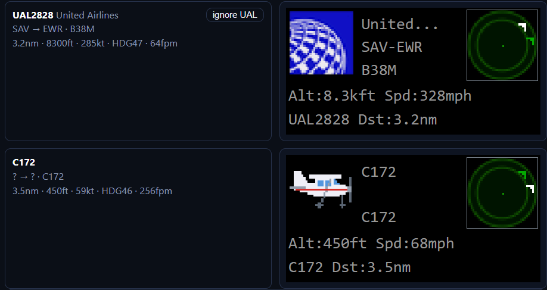
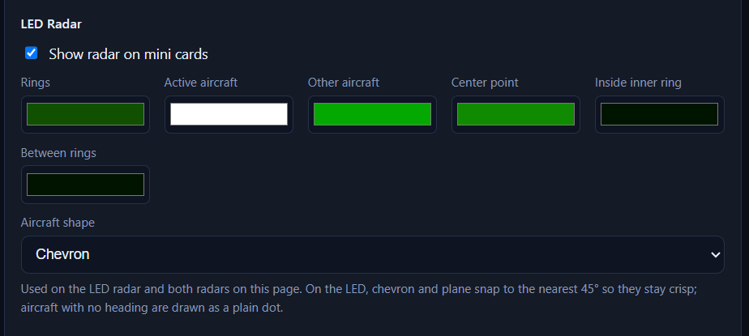
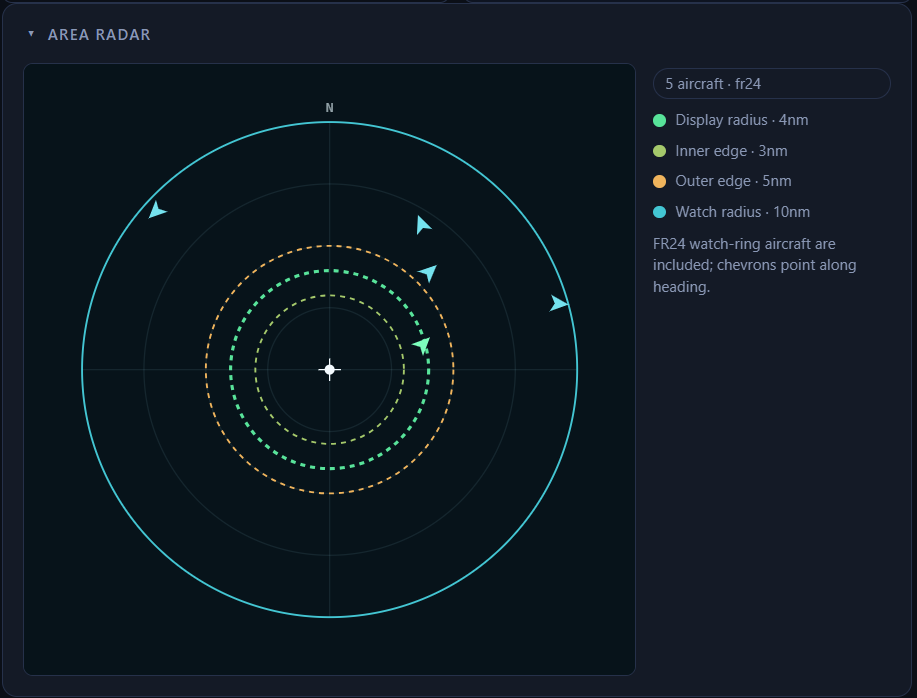
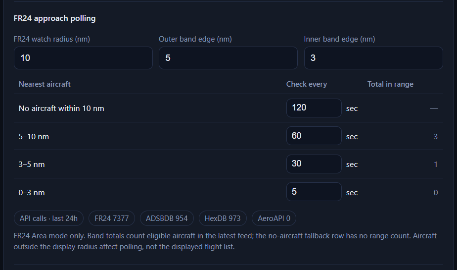
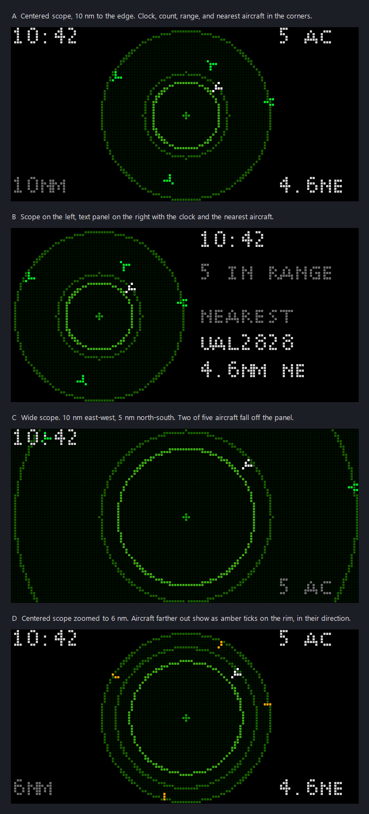
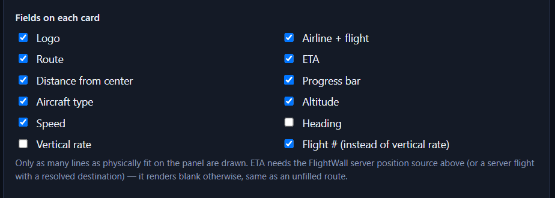
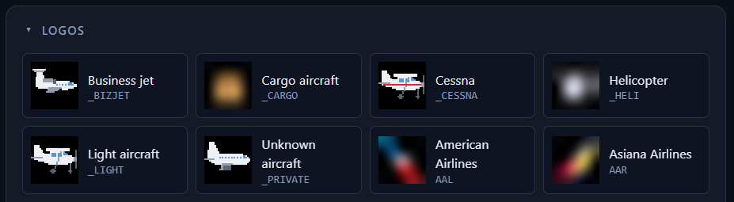

# Radar, card fields, and aircraft-type logos

This document describes three additions to the FlightWall firmware and web UI:

1. **Radar** — a live plot of nearby aircraft on the LED card and in the web UI, plus distance-based polling for the Flightradar24 source.
2. **Card field options** — three more fields that you can turn on or off for each flight card: the logo, the distance from center, and a route progress bar.
3. **Aircraft-type logos** — generic tiles (Cessna, light aircraft, business jet, helicopter, cargo, unknown) for flights that have no airline logo.

Each feature is self-contained. Each section ends with a list of the files involved, so you can lift any one of them into another branch.

## Radar

The radar answers "where is this aircraft relative to me?" at a glance. It has three parts that share the same data and settings:

- A 36×36-pixel **LED mini radar** in the top-right corner of each flight card.
- An **Area radar** card in the web UI that shows a larger, smoother version.
- **FR24 approach polling**, which fetches more often as the nearest aircraft gets closer.

### LED mini radar



The mini radar is drawn on the 128×64 "Mini" card. The screenshot shows the web UI's panel preview, which renders the same pixels as the LED.

What the radar shows:

- **Center point:** your configured location.
- **Outer ring:** the display radius. Aircraft beyond it aren't plotted.
- **Inner ring:** the inner band edge from the polling settings, clamped to the display radius.
- **Active aircraft:** the flight on the current card, in its own colour and drawn last so it stays on top.
- **Other aircraft:** everything else in range, including aircraft that aren't in the card rotation because of the max-flights cap or the airline filters.

North is up. Each aircraft's position comes from its bearing and distance from the center, and its marker shows its heading.

To turn the radar on:

1. Open the web UI and expand **Display**.
2. Under **LED Radar**, select **Show radar on mini cards**.
3. Optional: set the six colours (rings, active aircraft, other aircraft, center point, inside the inner ring, between the rings).
4. Optional: select an **Aircraft shape**.
5. Save.



The aircraft shapes are:

| Shape | Appearance |
|---|---|
| Dot with trail | A dot with a short line behind it. This is the default. |
| Chevron | An arrowhead that points along the heading. |
| Plane | A small top-view aircraft silhouette. |
| Dot with fading trail | A dot with a trail that fades out behind it. |
| Dot with nose tick | A dot with a short tick that points forward. |

On the LED, the chevron and plane snap to the nearest 45° so that they stay crisp at this size. An aircraft with no heading is drawn as a plain dot.

When the radar is on, the card layout changes to make room:

- The airline, route, and aircraft lines get fewer columns.
- The distance moves from the top-right corner to the bottom row, as `Dst:3.2nm`.

### Area radar in the web UI



The **Area radar** card draws the same aircraft at full resolution, with exact headings. It refreshes from the `GET /api/radar` endpoint.

Under the Flightradar24 source, the radar is scaled to the watch radius and shows four rings:

| Ring | Meaning |
|---|---|
| Display radius | Aircraft inside this ring appear on the wall. |
| Inner edge | The boundary of the fastest polling band. |
| Outer edge | The boundary of the middle polling band. |
| Watch radius | The limit of the area that the device fetches. |

Aircraft are coloured by where they are: inside the display radius, between the display radius and the outer edge, or out in the watch ring.

Under the other position sources, the radar shows only the display-radius ring, because those sources don't use a watch ring.

### FR24 approach polling



A fixed fetch interval forces a trade-off: poll slowly and an aircraft can cross your window between fetches, or poll quickly and send many requests when nothing is nearby. Approach polling removes the trade-off. The device fetches a wider area than it displays and picks the next interval from the distance of the nearest aircraft.

The settings are in the web UI under **Tracking**. They appear only when the mode is **Area** and the position source is **Flightradar24**.

| Nearest aircraft | Default interval |
|---|---|
| None within the watch radius | 120 seconds |
| Between the outer edge and the watch radius | 30 seconds |
| Between the inner edge and the outer edge | 15 seconds |
| Inside the inner edge | 10 seconds |

The default distances are a 20 km watch radius, a 10 km outer edge, and a 5 km inner edge. The fields use the distance unit that you select (km, mi, or nm).

How it behaves:

- **Fetch area:** the device requests the larger of the display radius and the watch radius.
- **Display:** aircraft in the watch ring affect only the polling interval. They are never shown on a card and never trigger an enrichment lookup.
- **Eligibility:** only aircraft that pass the on-ground and altitude filters count toward the nearest distance and the band totals.
- **Clamping:** the outer edge is kept between the display radius and the watch radius, and the inner edge is kept at or below the outer edge. The minimum interval is 5 seconds.
- **Backoff:** the existing failure and empty-reply backoff still applies on top, so a rate-limited feed still slows the device down.
- **Fetch interval setting:** in this mode, the band intervals replace the general **Fetch interval** setting.

The **Total in range** column shows how many eligible aircraft the latest feed had in each band. The row of pills below the table shows API call counts for the last 24 hours, which helps you tune the intervals against the request volume.

### Full-panel radar when there are no flights

The **When no flights** setting, under **Display**, has four radar screens. They draw the aircraft that the device knows about outside the display radius, so an empty wall still shows the traffic around it.



| Setting | Value | Layout |
|---|---|---|
| **Radar — centered** | `radar` | A round scope in the middle. The clock, the aircraft count, the range, and the nearest aircraft's distance and direction sit in the four corners. |
| **Radar — with nearest aircraft** | `radarinfo` | The scope on the left, with a text panel on the right: the clock, the count, and the nearest aircraft's callsign, distance, and direction. |
| **Radar — full width** | `radarwide` | The scope scaled to the panel width, so the range reaches the left and right edges. Aircraft far to the north or south fall off the panel. |
| **Radar — zoomed** | `radarzoom` | A centered scope that shows 60% of the range, but never less than the display radius. Aircraft farther out appear as amber ticks on the rim, in their direction. |

The range is the FR24 watch radius under Flightradar24 in Area mode, and the display radius otherwise. The colours and aircraft shape come from the **LED Radar** settings, and the nearest aircraft uses the active-aircraft colour. The **B** button cycles through these four modes along with the others.

### Limitations

- **FlightWall server source:** the LED mini radar draws its rings but plots no aircraft, because the server returns a finished flight list and no raw positions. The web UI radars still plot the displayed flights. A fallback cycle to adsb.lol plots normally.
- **Aircraft cap:** the radar keeps the 40 nearest aircraft per fetch.
- **Card layouts:** only the 128×64 Mini card draws the radar.

### Radar files

| File | Role |
|---|---|
| `firmware/adapters/Hub75Display.cpp` | `drawMiniRadar()`, the Mini card layout changes, `drawRadarScreen()` for the four no-flights layouts, and `drawRadarMark()`, which both radars use to draw an aircraft. |
| `firmware/utils/FetchCadence.h` | `fr24ApproachIntervalMs()`, the band-to-interval rule. |
| `firmware/src/main.cpp` | Chooses the next interval and passes radar positions to the display and web server. |
| `firmware/core/FlightDataFetcher.cpp` | Fetches the watch radius, collects radar positions, and keeps watch-ring aircraft off the cards. |
| `firmware/adapters/FlightRadar24Fetcher.cpp` | Counts eligible aircraft per band. |
| `firmware/core/Settings.h`, `Settings.cpp` | `showRadar`, the radar colours and shape, and the `fr24*` tracking settings. |
| `firmware/core/WebConfigServer.cpp` | `GET /api/radar` and the band counts in `GET /api/status`. |
| `firmware/data/index.html` | The Area radar card, the mini radar preview, and the settings controls. |
| `firmware/test/test_fetchcadence.cpp` | Host tests for the interval rule. |

## Card field options



The **Fields on each card** list in the web UI, under **Display**, controls what each flight card shows. Three of the twelve checkboxes are additions. All three are on by default.

| Checkbox | What it controls |
|---|---|
| **Logo** | The logo tile on the Mini card. When you clear it, the airline, route, and aircraft lines use the full width of the card. |
| **Distance from center** | The distance between the aircraft and your configured center point, labeled `Dst`. |
| **Progress bar** | A bar along the bottom of the card that shows how much of the route the aircraft has flown. |

The other nine checkboxes are unchanged from upstream: **Airline + flight**, **Route**, **ETA**, **Aircraft type**, **Altitude**, **Speed**, **Heading**, **Vertical rate**, and **Flight # (instead of vertical rate)**.

### Distance from center

The distance uses the unit that you select in **Tracking > Distance units**: kilometers, miles, or nautical miles. The unit setting is also an addition, and it applies to the radius fields and the web UI flight list as well.

Where the distance appears depends on the radar:

- **Radar off:** the distance sits at the right of the top lines, when the route line leaves room for it.
- **Radar on:** the distance moves to the bottom row, as `Dst:3.2nm`.

### Progress bar

Upstream draws a progress bar only on a tracked card, which is a flight that you watch through a FlightWall server. That bar is based on the flight's schedule.

The addition is a route bar for every other card. When a flight's origin and destination coordinates are both known, the bar shows the share of the great-circle distance that the aircraft has covered. A flight with no resolved route has no bar.

The **Progress bar** checkbox turns both bars on or off. A **Progress bar color** setting, also under **Display**, sets the fill colour.

### Card field files

| File | Role |
|---|---|
| `firmware/core/Settings.h`, `Settings.cpp` | `showLogo`, `showDistance`, and `showProgressBar` in `DisplayLayout`, plus the progress bar colour and `distanceUnit`. |
| `firmware/adapters/Hub75Display.cpp` | `displayMiniCard()` applies the three options and draws the route bar. |
| `firmware/utils/RouteDistance.h` | `routeProgressPct()`, the great-circle share of the route flown. |
| `firmware/data/index.html` | The checkboxes, the colour and unit controls, and the panel preview. |
| `firmware/test/test_routedistance.cpp` | Host tests for the route progress calculation. |

## Aircraft-type logos



Airline flights get an airline tile. Private and general-aviation flights have no airline, so they have no logo to show. Six generic 32×32 tiles cover those flights:

| Tile | Shown for | Status |
|---|---|---|
| `_CESSNA` | Known Cessna piston and turboprop types, such as the C172 and C208. A side view with a red stripe. | New |
| `_LIGHT` | Other light aircraft, such as Piper, Cirrus, Diamond, Mooney, and Beechcraft. The same side view without the stripe. | New |
| `_BIZJET` | Business jets, such as Gulfstream, Learjet, Challenger, Falcon, and Cessna Citation. | New |
| `_HELI` | Helicopters. | Unchanged from upstream |
| `_CARGO` | Known cargo operators that have no tile of their own. | Unchanged from upstream |
| `_PRIVATE` | A tail-number flight whose aircraft type is unknown. The web UI labels it "Unknown aircraft". | Redrawn as an airliner side view |

The aircraft-type classifier, the tile order, and the embedding of the tiles into the firmware are also new.

### How a tile is chosen

The firmware classifies each flight from its ICAO type code, with the manufacturer and model text as a fallback. A helicopter is also recognised from its ADS-B emitter category.

The firmware then tries these tiles in order and draws the first one that exists:

1. `_HELI`, when the aircraft is a helicopter.
2. For a tail-number flight: the class tile (`_CESSNA`, `_LIGHT`, or `_BIZJET`) when the type is known, otherwise `_PRIVATE`.
3. The operator's own airline tile.
4. `_CARGO`, when the operator is a known cargo carrier.
5. The class tile, for an airline-format callsign whose operator has no tile.

Two details in the classifier are deliberate:

- **Citations are business jets:** the business-jet check runs before the Cessna check, so a Cessna Citation gets `_BIZJET`.
- **Cessna type codes are an explicit list:** `C130`, `C17`, and `C5` are military transports, so a "C plus digits" rule would be wrong.

The LED and the web UI preview call the same function, so they can't disagree about which tile a flight gets.

### How the tiles are stored

The six tiles are compiled into the firmware, and the built-in copies take priority over the files in `/logos/` on LittleFS. A normal firmware upload, including an OTA upload, carries them. You don't need to upload a filesystem image.

The **Logos** card in the web UI lists the generic tiles first, followed by the airline tiles.

### Change or regenerate the tiles

The tiles are drawn by two scripts. No tile uses external or trademarked artwork.

1. To change the helicopter or cargo tile, edit `tools/gen_special_logos.py`, then run it. It requires Pillow.

   ```bash
   pip install pillow
   python tools/gen_special_logos.py
   ```

2. To change an aircraft tile, edit `tools/gen_generic_tiles.py`.
3. Run `tools/gen_generic_tiles.py`. It has no dependencies. It writes the aircraft tiles and embeds every `_*.rgb565` tile into `firmware/core/GenericTiles.cpp`.

   ```bash
   python tools/gen_generic_tiles.py
   ```

4. Rebuild and upload the firmware.

Always run `gen_generic_tiles.py` last, because it's the step that embeds the tiles.

### Logo files

| File | Role |
|---|---|
| `firmware/utils/FlightClassify.h` | `classifyAircraftIcon()` and `logoCandidates()`, the classifier and the tile order. |
| `firmware/core/GenericTiles.h`, `GenericTiles.cpp` | The embedded tile data. `GenericTiles.cpp` is generated. |
| `firmware/core/FlightDataFetcher.cpp` | Sets each flight's aircraft class and helicopter flag. |
| `firmware/adapters/Hub75Display.cpp` | Loads the first available tile, built-in copies first. |
| `firmware/core/WebConfigServer.cpp` | `GET /api/logo` and `GET /api/logos` for the web UI. |
| `firmware/data/logos/_*.rgb565` | The tile files that the scripts write. |
| `tools/gen_generic_tiles.py`, `tools/gen_special_logos.py` | The tile generators. |
| `firmware/test/test_classify.cpp` | Host tests for the classifier and the tile order. |
